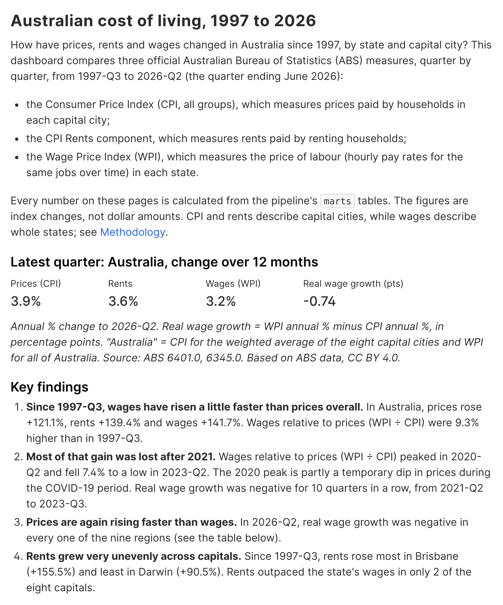
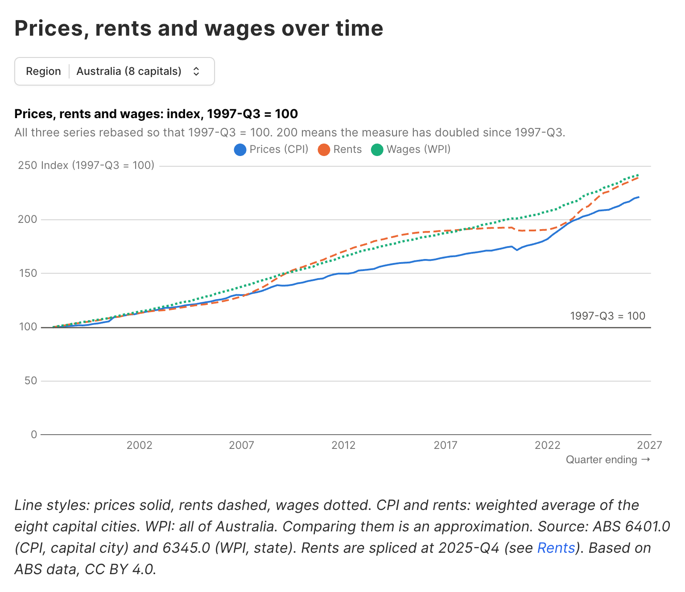
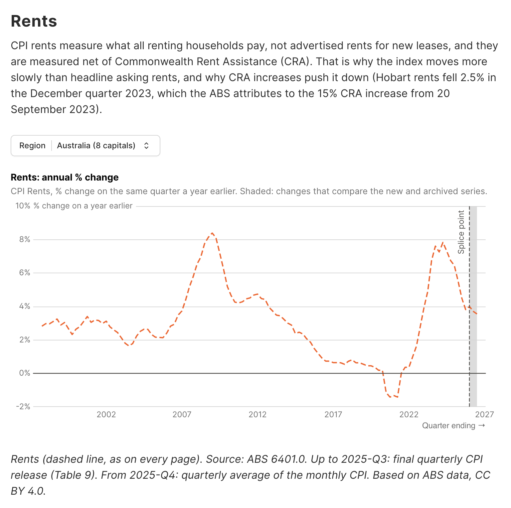
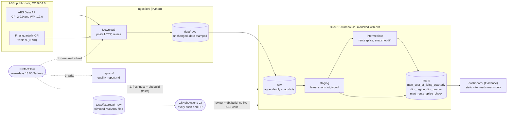

# Australian Cost-of-Living Pipeline


<!-- Replace <your-github-user>/<your-repo> after pushing to GitHub. -->

**How have rents, wages and inflation changed over time, by state and capital city in Australia?**

This is an end-to-end data engineering project:
- It pulls official Australian Bureau of Statistics (ABS) data and stores the raw files unchanged.
- It models the data with dbt in DuckDB and tests it at every layer (128 dbt checks, 70 offline Python tests).
- It runs on a local schedule with Prefect, is tested in CI, and serves a static dashboard built with Evidence.

Everything is free, runs locally and needs no accounts or keys.

<!-- Screenshots: add your own images, e.g. docs/images/overview.png, then uncomment.



-->
> **Screenshots:** _placeholder. Add `docs/images/overview.png`, `over-time.png` and `rents.png`, then uncomment the block above._

> Personal portfolio project using public data only. Not financial or immigration advice.

## Findings

These are for 1997-Q3 to 2026-Q2. Each figure comes from a named query in [`docs/findings_queries.sql`](docs/findings_queries.sql), and `python -m orchestration.findings` re-runs them. Full table, with what the data does **not** show: [`docs/findings.md`](docs/findings.md).

1. **Over the whole period, wages rose a little faster than prices.** In Australia, prices rose **+121.1%**, rents **+139.4%** and wages **+141.7%**. Wages relative to prices ended **9.3%** higher. *(F1)*
2. **Most of that gain was lost after 2021.** Wages relative to prices peaked in 2020-Q2 and then fell **7.4%** to a low in 2023-Q2. Real wage growth was negative for **10 quarters in a row** (2021-Q2 to 2023-Q3). The 2020 peak partly reflects a temporary COVID-period dip in prices. *(F2, F4)*
3. **Prices are again outpacing wages, in every region.** Real wage growth has been negative since 2025-Q4. In 2026-Q2 it was below zero in all 9 regions, from −0.47 points (Victoria) to −1.77 (Tasmania). *(F4, F5)*
4. **Rent growth varied widely by capital.** Since 1997-Q3, rents rose +155.5% in Brisbane but +90.5% in Darwin. Rents outpaced the state's wages only in Brisbane and Sydney. *(F6)*

These describe how the indexes moved, not why. They are index changes, not dollar levels or affordability. CPI rents are not advertised market rents.

## Architecture



## Tech stack, and why

| Tool | Why it was chosen |
|---|---|
| **Python 3.12** + `requests` | Simple, typed ingestion with retries, timeouts and a polite request rate. |
| **DuckDB** | A single-file analytical database: no server, fast, free. dbt and Evidence both read it directly. |
| **dbt Core** (dbt-duckdb) | SQL models with tests, docs and lineage. Each layer (staging, intermediate, marts) is testable. |
| **Prefect 3** | One local flow with retries, logs and a cron schedule, plus a local UI. No cloud is needed; analytics are switched off. |
| **pytest** | 70 tests that run offline (external network is blocked in tests). |
| **GitHub Actions** | Free CI. It runs pytest and `dbt build` against small committed fixtures, never the live ABS. |
| **Evidence 40** (pinned) | Dashboards as SQL plus Markdown, built to a static site that reads DuckDB read-only. See "Design decisions". |
| **pip-tools** | One readable `requirements.txt` and a fully pinned `requirements.lock`. |

## Run it from scratch

Requirements: Python 3.12, Node.js 18 or newer (tested on 22), git. On macOS or Linux:

```bash
git clone https://github.com/<your-github-user>/<your-repo>.git && cd <your-repo>
python3.12 -m venv .venv && source .venv/bin/activate
pip install -r requirements.lock
cp dbt_project/profiles.yml.example dbt_project/profiles.yml
python ingestion/init_duckdb.py
python -m orchestration.flow          # download ABS data (4 requests), load, freshness, dbt build, quality report
pytest                                # 70 offline tests
```

The flow exits with code 1 and prints `PIPELINE FAILED` if any test or freshness check fails. The report is always written to `reports/quality_report.md`.

### View the dashboard locally

```bash
cd dashboard
npm ci                                # exact pinned versions from the lock file
npm run sources                       # read the marts (read-only)
npm run dev                           # live preview: http://localhost:3000
# or build the static site and serve it:
npm run build:strict && npm run preview
```

### Schedule it (optional)

```bash
PREFECT_SERVER_ANALYTICS_ENABLED=false prefect server start                # terminal 1
PREFECT_API_URL=http://127.0.0.1:4200/api python -m orchestration.serve    # terminal 2
```

This runs on weekdays at 13:00 Australia/Sydney, while both processes are running and the computer is awake. Details are in [`docs/operations.md`](docs/operations.md).

### Publish the dashboard on GitHub Pages (manual, optional)

Nothing deploys automatically. If you want a public copy, do this yourself:

```bash
# 1. Build with the repo name as base path (GitHub project pages live under /<your-repo>/)
cd dashboard
cp evidence.config.yaml /tmp/evidence.config.yaml.bak
printf '\ndeployment:\n  basePath: /%s\n' "<your-repo>" >> evidence.config.yaml
npm run sources && npm run build:strict
cp /tmp/evidence.config.yaml.bak evidence.config.yaml   # restore the local config

# 2. Put the built files on an orphan gh-pages branch, from a separate clone
cd /tmp && git clone https://github.com/<your-github-user>/<your-repo>.git site && cd site
git switch --orphan gh-pages
cp -R "<path-to-your-repo>/dashboard/build/." .
touch .nojekyll                                 # keep the _app/ folder (GitHub Pages would hide it)
git add . && git commit -m "Publish dashboard" && git push origin gh-pages
```

Then in the repository's **Settings → Pages**, set *Deploy from a branch* to `gh-pages` / `(root)`. The published site contains the mart data (public ABS data, CC BY 4.0). Viewers' browsers fetch DuckDB's Parquet extension from `extensions.duckdb.org`.

## Design decisions (what I learned)

- **Splicing the rents series.** The ABS moved the CPI to monthly in late 2025 and stopped quarterly capital-city tables after 2025-Q3. Monthly city rents only go back to 2022-07. So the rents series joins the archived quarterly series (to 2025-Q3) onto quarterly averages of the monthly series (from 2025-Q4), linked at 2025-Q3.
  - In the overlap, the two series drift by 0.14% to 0.41%.
  - This is measured in `mart_rents_splice_check`, tested against a 0.5% tolerance, and flagged on every affected row.
  - Lesson: measure the join, don't assume it.
- **Rebasing to 1997-Q3 = 100.** The three series come on different bases: Sep 2025, 2008-09 and 2011-12. 1997-Q3 is the first quarter in which all three exist, because the WPI starts then. Rebasing there makes every line start together, so charts read as cumulative change. Annual % changes are unaffected.
- **No dbt incremental models.** The whole dbt build takes about 4 seconds. More importantly, the ABS revises history, so staging must re-read the newest download in full. Incremental models would need merge keys and frequent full refreshes, for no benefit. Incremental behaviour lives where it pays off: the raw loader appends each new file once.
- **Why Evidence, and why version 40.1.8.** Evidence keeps dashboards in git as SQL plus Markdown, reads DuckDB read-only, and builds a plain static site.
  - In August 2026 Evidence moved to a new CLI tied to its cloud product. The project pins the last open-source npm release from its lock file. That release still builds, but it's frozen: 58 npm advisories in the build toolchain, documented in [`dashboard/README.md`](dashboard/README.md).
  - Lesson: check that a tool still works the way you remember before building on it.
- **Tools phone home by default.** Prefect's server, dbt and Evidence each send anonymous usage data unless told not to. All three are switched off. The dashboard's telemetry module is also replaced by a no-op, because Evidence's documented environment-variable opt-out is ignored on the code paths that send events.
- **Every number must trace to a query.** Writing the findings from queries caught two of my own earlier mistakes in the docs: the real-wage approximation error is 0.40 points, not about 0.3; and the ABS revision flags were on a series the project doesn't use.

## Limitations

- **City vs state.** CPI and rents are measured for capital cities, the WPI for whole states, so each region's comparison is an approximation.
- **CPI rents are not market rents.** They cover all renting households, net of Commonwealth Rent Assistance, so CRA increases push them down.
- **The splice adds noise.** Annual rent changes from 2025-Q4 compare the new and archived series, so treat them as ±0.4 points.
- **Real wage growth is a simple difference** (WPI % − CPI %). The exact ratio form differs by up to 0.40 points (2022-Q4).
- **Original series only.** The WPI is the price of labour for the same jobs, not average earnings.
- **Revisions.** ABS revisions change recent values; the pipeline keeps every download and reports what changed.
- **Unexplained:** Hobart rents fell in the December quarter 2024, and the cause hasn't been verified.
- Full list: [`docs/data_dictionary.md`](docs/data_dictionary.md#known-limitations) and the dashboard's Methodology page.

## What I would improve next

- **Self-host DuckDB's Parquet extension** in the static site, so viewers' browsers contact no third-party host.
- **Move off the frozen Evidence 40.** Either migrate to the new Evidence or to a small Python static-site generator, and clear the npm advisories.
- **Add a dollar-level view** (for example ABS median rents or average weekly earnings) so affordability, not just growth, can be shown.
- **Add regional (non-capital) data** where the ABS publishes it, to narrow the city-vs-state approximation.
- **Build and publish the dashboard in CI** as a manual-approval GitHub Pages workflow.

## Project structure

| Path | Purpose |
|---|---|
| `ingestion/` | Download and load code, one module per source, plus the CI fixture tool |
| `dbt_project/` | Seeds; staging, intermediate and mart models; generic and singular tests; freshness |
| `orchestration/` | Prefect flow and schedule, dbt runner, quality report, findings runner |
| `dashboard/` | Evidence site: `sources/` (marts only) and `pages/` |
| `tests/` | Offline pytest suite and CI fixtures |
| `docs/` | Data sources, data dictionary, operations guide, findings and their queries |
| `.github/workflows/` | `ci.yml` (every push and PR), `live-ingestion.yml` (manual) |

## Data and attribution

Based on Australian Bureau of Statistics data: Consumer Price Index, Australia (6401.0) and Wage Price Index, Australia (6345.0), licensed under [CC BY 4.0](https://creativecommons.org/licenses/by/4.0/). The figures shown are derived (rebased, averaged, spliced and differenced) and are not ABS publications. Dataflow IDs, URLs and licence notes: [`docs/data_sources.md`](docs/data_sources.md).
